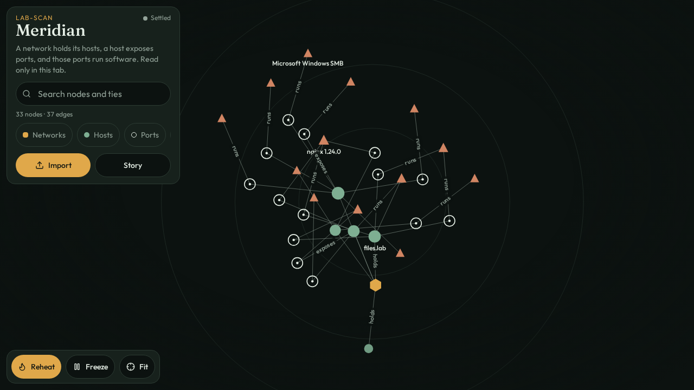
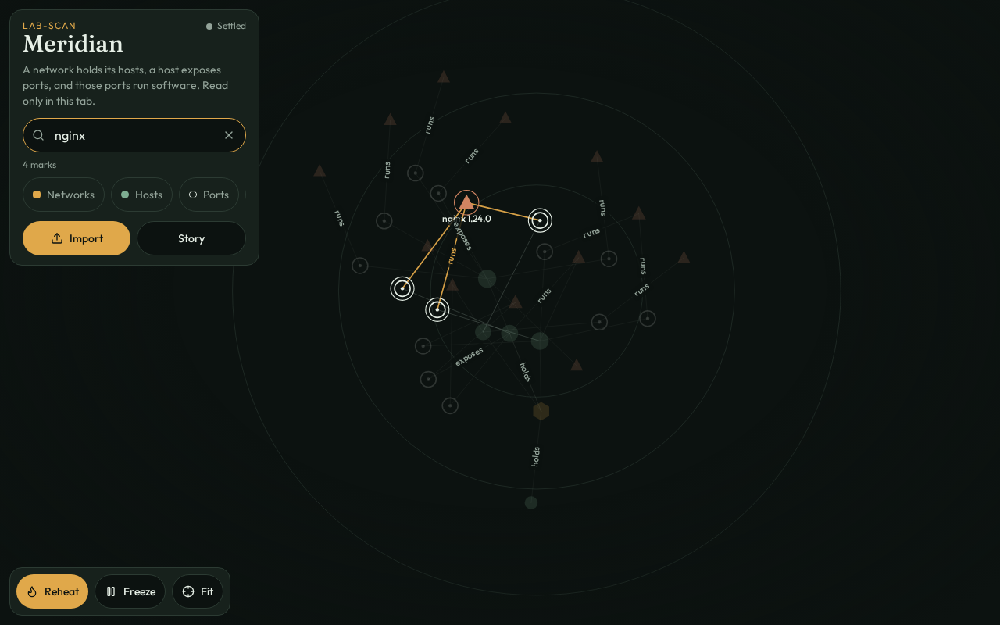
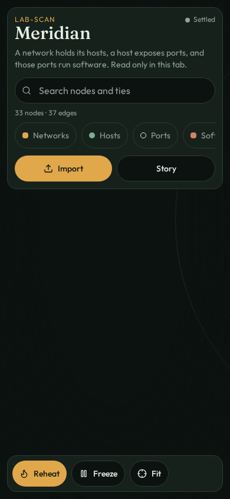

<div align="center">

# Meridian
### See the relationships behind your network scan.

**A local-first, interactive network relationship graph for hosts, ports, services, software and discovered files.**

[Get started](#quick-start) · [Import formats](#import-existing-scan-results) · [Local scanner](#optional-local-scanner) · [Graph semantics](#how-the-graph-works)

</div>



## Why Meridian?

A scan can tell you which ports are open. It is less good at showing **what your hosts have in common**.

Meridian turns the output of familiar reconnaissance tools into a navigable graph: a network contains hosts, hosts expose ports, ports run software, and the same software version can connect several hosts. Instead of reading another enormous results table, you can explore the connections.

This is a small experimental visualization project, **not** a vulnerability scanner or a replacement for Nmap, Burp Suite or a full asset-management platform.

### What you can do

- Import existing scan results as **Nmap XML / normal / grepable**, **Masscan XML**, **CSV**, plain **IP lists**, or Meridian JSON.
- Navigate a force-directed graph; pan, zoom, drag, search and filter by node type.
- Spot shared services or versions across hosts without treating every repeated banner as a separate piece of software.
- Visualize script/data-file paths captured by Meridian's scanner.
- Use the included **Sample** lab dataset to explore the interface without touching a network.
- Optionally run a small local Python scanner and import its JSON output.

**Privacy:** imported files are parsed locally in the browser; the import flow does not upload them to a scanning service. The optional scanner does send traffic to the targets you specify. The web application has other dependencies and infrastructure; do not interpret local file parsing as a blanket guarantee that all app traffic stays offline.

## Screenshots

| Full scan | Shared software search |
| --- | --- |
|  |  |



## Quick start

**Requirements:** Node.js and npm (use a recent compatible Node.js release), plus Python 3 if you want to run the optional scanner.

```bash
git clone https://github.com/MKlolbullen/nodey-physics.git
cd nodey-physics
npm ci
npm run dev
```

The development script starts Vite on **port 8080**. Open the URL shown in the terminal, choose **Sample**, or import your own scan file.

The repository also includes application/server and database-related functionality. Depending on your environment, those paths may require additional configuration; the instructions above describe the development entry point, not a claim of zero-configuration production deployment.

Useful repository commands:

```bash
npm run typecheck
npm run lint
npm test
npm run build
```

Note: `npm run build` also runs database migrations. Review environment/database configuration before invoking it outside development.

## Import existing scan results

Use **Import**, or drag and drop a supported file into the graph.

| Format | Typical producer | Notes |
| --- | --- | --- |
| Nmap XML | `nmap -oX scan.xml ...` | Hosts, ports, services and available OS details |
| Nmap normal | `nmap -oN scan.nmap ...` | Human-readable Nmap output |
| Nmap grepable | `nmap -oG scan.gnmap ...` | Legacy line-oriented format |
| Masscan XML | Masscan XML export | Host/port data with compatible XML structure |
| CSV | Other inventory tools | Headers such as `ip`/`address`, `port`, `protocol`, `state`, `service`, `product`, `version`, `os`, `hostname`, `mac`; semicolon and tab delimiters supported |
| IP list | Any text file | One IP address per line |
| Meridian JSON | Included scanner | Additional DNS, crawled pages and file relationships |

You can start with an existing report—**no new target scan is needed** just to draw the graph.

## How the graph works

```text
Network ──holds────> Host ──exposes──> Port ──runs──> Software
                       │                 │
                       └──runs───────────> OS
                                         └──serves──> File
```

| Relationship | Meaning |
| --- | --- |
| Network → Host | Host belongs to the same IPv4 /24 or IPv6 prefix |
| Host → Port | Open port and transport, e.g. `443/tcp` |
| Port → Software | Service/product/version, shared across matching ports |
| Host → Software | Detected operating system |
| Port → File | Discovered `.js`, `.json`, `.map`, `.chunk` or `.ts` path |

**Node shapes:** networks are hexagons, hosts discs, ports rings, software triangles and files pages. Click a node to inspect available facts such as address, banner, OS, latency, page title or open-port count.

Meridian collapses some OS/package-specific banner suffixes to a common upstream product version for visualization. This makes shared software easier to see, but **is not proof that two hosts have identical patch levels**.

### Boundaries and performance

- Closed and filtered ports aren't displayed.
- Down hosts with no open ports are excluded.
- Large imports prioritize up to **120 hosts** with the most open ports.
- Above **100 open ports**, port details stay on the host card while software relationships remain visible.
- A file path served by more than one host can become a shared node.

## Optional local scanner

The Python scanner collects a modest amount of network and HTTP metadata and writes import-ready artifacts:

```bash
python3 scanner/meridian.py
```

Enter a **hostname**, **CIDR**, or **IP range** when prompted. The script also accepts a target argument for a one-shot run.

It processes the target in sequence:

1. TCP-connect discovery over a small predefined port set, retaining available banners.
2. PTR resolution for live addresses; hostname DNS lookups and a short subdomain-label list when a domain was supplied.
3. Bounded same-host, same-port HTTP(S) crawling (up to two hops and 20 pages per origin).
4. Discovery of referenced script/data files and source maps.

Output is written to the current directory as `meridian-<target>.json` and `.csv`. Import the JSON for the richest relationship graph.

**Scanner guardrails:** a 512-address cap, bounded crawling, and skipping link-local/metadata addresses. These are operational limits, not a substitute for checking authorization and target scope. The scanner runs locally but sends network requests; it does not query Shodan/Censys/VirusTotal/FOFA automatically.

Only scan systems you own or have explicit permission to assess.

## Other tool outputs

Meridian is built around a **shared graph vocabulary**. Results from tools such as [dnsx](https://github.com/projectdiscovery/dnsx), [httpx](https://github.com/projectdiscovery/httpx), [tlsx](https://github.com/projectdiscovery/tlsx), and [katana](https://github.com/projectdiscovery/katana) could enrich the same host, port, software and file entities.

**Current limitation:** those tools and third-party intelligence APIs are *not* direct live integrations in this project. Normalize their output to one of the supported formats before importing; the graph will only represent fields the parser actually recognizes. CVE/enrichment hubs are architectural ideas, not a claim of implemented vulnerability correlation.

## Development and validation

The repository includes a scan parser test and Python scanner tests, alongside application checks:

```bash
npm run typecheck
npm run lint
npm test
python3 -m unittest scanner.test_meridian
```

No benchmark, production-hardening guarantee or independent security audit is claimed here.

## Next ideas

- Explicit graph entities for validated vulnerabilities and evidence links.
- More structured input adapters for reconnaissance tool output.
- Improved handling and aggregation of large scan datasets.
- Stronger end-to-end tests for imports and scanner output.

---

**Meridian** is a small experiment in making scan results more useful by showing how the pieces connect.

Built by [MKlolbullen](https://github.com/MKlolbullen).
